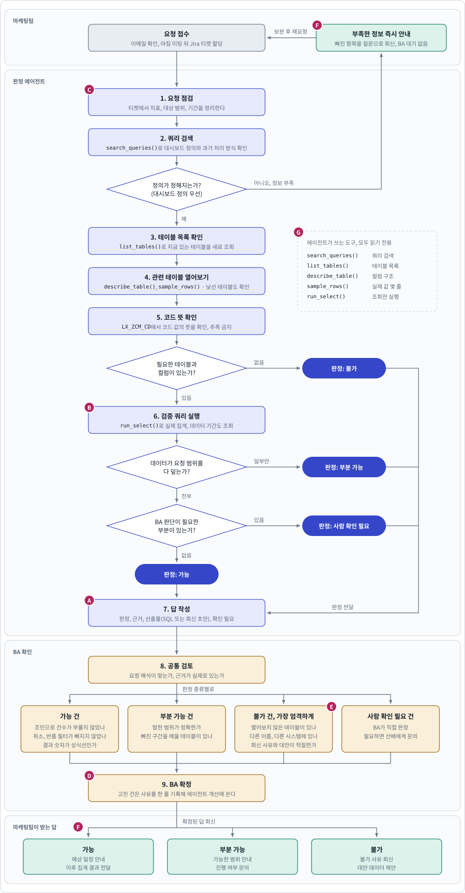

# 집계 가능 여부 판정 에이전트

BA팀 판정 에이전트 시제품 · LangChain Deep Agents 기반 · 2026-11-21

> “일이 밀릴 때 새벽배송 데이터를 집계할 수 있나 하면서 테이블 뒤져보고 (SQL) - 선배한테 물어보고 - 안된다고 판단되면 안된다고 마케팅팀에 통보”
>
> — 이 시제품의 주안점

**티켓이 몰릴 때, 요청마다 집계가 가능한지 판정하는 데 드는 시간을 줄인다.**

마케팅팀의 요청 한 건을 넣으면 에이전트가 과거 쿼리와 테이블을 직접 확인해 `가능`, `부분 가능`, `불가`, `정보 부족`, `사람 확인 필요` 가운데 하나로 판정하고, 근거와 산출물(SQL 또는 회신 초안)을 함께 낸다. 마케팅팀에 나가는 답은 BA가 확정한다.

## 판정 순서도

마케팅팀 요청이 들어와 답이 나가기까지 누가 무엇을 하는지, 그리고 성공을 어디에서 재는지 한 장에 담았다. 분홍색 원(A~G)은 아래 표의 지표를 재는 곳이다.



에이전트는 먼저 대시보드 패널 쿼리와 과거 쿼리를 검색해 정의를 정한다. 대시보드에 정의가 있으면 그 정의로 답하고, 정의가 정해지지 않으면 BA를 기다리지 않고 곧바로 되묻는다. 나머지는 테이블을 직접 열어 판정하고, BA가 근거를 검토해 확정한 답만 마케팅팀에 전달된다.

## 지표와 재는 곳

시제품의 대표 지표는 **A 의도된 성공률**이다. 골드셋 30문항 가운데 의도한 결과를 낸 문항의 수로 센다. 운영에 들어가면 F 첫 회신 시간이 대표 지표가 된다. 목표는 기준선을 재기 전의 제안값이다.

| 표시 | 지표 | 재는 곳 | 정의 | 목표(제안) | 현재 |
|---|---|---|---|---|---|
| A | **의도된 성공률** | 7. 답 작성 | 골드셋 30문항 중 판정과 숫자가 모두 의도와 같은 문항 수 | 90% 이상 | **27/30 (90%)** |
| B | 대시보드 숫자 일치 | 6. 검증 쿼리 실행 | 대시보드 캡처의 숫자 29개 중 에이전트의 SQL 결과로 재현된 개수 | 29/29 | 29/29 (연습용 DB) |
| C | 판정 1건 소요 시간 | 1번부터 7번까지 | 티켓 하나를 받아 답을 쓰기까지 걸린 시간 | 2분 이내 | 평균 30초 |
| D | 무수정 채택률 | 9. BA 확정 | BA가 고치지 않고 확정한 판정의 비율 | 80% 이상 | 운영 후 측정 |
| E | 뒤집힌 불가 | 불가 건 검토 | 에이전트의 불가를 BA가 뒤집은 건수 | 0건 | 운영 후 측정 |
| F | 첫 회신 시간 | 요청 접수부터 답 또는 되묻기까지 | 티켓 생성부터 요청자가 첫 판정이나 질문을 받기까지 걸린 시간 | 1영업일 | 몰릴 때 약 2주 (고객 진술, 미측정) |
| G | 개인정보 노출 | 도구 | 가림 대상 컬럼의 값이 모델에 전달된 횟수 | 0건 | 도구 점검에서 가림 동작 확인 |

A, B, C의 현재 값은 2026-11-21에 `openai:gpt-5.5`로 한 번 실행한 결과다. 문항별 답과 SQL은 [gold_results.md](gold_results.md)에 있다.

## 골드셋 30문항

정답을 미리 정해 둔 질문 30개다([gold.json](gold.json)). 숫자 문항은 판정과 숫자가 모두 맞아야 통과로 센다. 대시보드 문항은 캡처(10월분, 11월 1일 06시 갱신본)의 숫자가 정답이고, 그 밖의 숫자 문항은 문항에 적어 둔 기준 계산식을 실행한 결과가 정답이다.

| 유형 | 문항 | 통과 | 보는 것 |
|---|---|---|---|
| 대시보드 지표 | 6 | 6 | 대시보드와 같은 정의로 같은 숫자를 내는가 |
| 대시보드 지표의 변형 | 3 | 3 | 기간이나 묶는 방식이 달라져도 같은 정의를 쓰는가 |
| 티켓이 기준을 밝힌 요청 | 2 | 2 | 요청자가 밝힌 기준을 따르는가 |
| 쿠폰, 회원, 사이트 행동, 푸시 | 6 | 6 | 대시보드에 없는 지표를 집계하는가 |
| 데이터에 없는 것 | 4 | 3 | 없는 것을 없다고 말하는가 |
| 기간의 한계 | 3 | 2 | 되는 기간과 안 되는 기간을 나누는가 |
| 되물어야 하는 요청 | 3 | 2 | 되물어야 할 때 되묻는가 |
| 사람이 봐야 하는 요청 | 3 | 3 | 위험한 요청을 사람에게 넘기는가 |
| **합계** | **30** | **27** | |

통과하지 못한 세 문항은 숫자가 틀린 것이 아니라 판정의 경계에서 갈렸다. 정답 숫자는 202개가 모두 일치했다.

| 번호 | 요청 | 기대 | 실제 | 갈린 지점 |
|---|---|---|---|---|
| G08 | 올해 월별 주문 건수를 작년 같은 달과 비교 | 불가 | 부분 가능 | 작년 데이터가 없는데, 올해 숫자만 줄 수 있다는 이유로 부분 가능이라 답했다 |
| G24 | 올해 세탁기를 산 고객을 연령대별, 성별로 | 불가 | 부분 가능 | 연령과 성별이 없는데, 전체 구매 고객 수는 줄 수 있다는 이유로 부분 가능이라 답했다 |
| G27 | 쿠폰을 받고 안 쓴 사람에게 보낼 푸시 대상 추출 | 정보 부족 | 사람 확인 필요 | 조건이 빠진 요청이면서 명단 요청이다. 지금은 명단 정책이 먼저 적용되는데, 어느 쪽이 먼저여야 하는지는 정하지 않았다 |

핵심 요청은 안 되지만 기본 숫자는 줄 수 있을 때 `불가`인지 `부분 가능`인지는 BA가 정할 기준으로 남겨 두었다.

## 의미 계층

[semantic_layer.yaml](semantic_layer.yaml)은 에이전트가 판정의 근거로 삼는 사전이다. 지표 18개의 계산식, 나누는 기준 14개, 데이터에 없는 것 7가지, 정책 8개, 테이블 35개와 컬럼 132개의 쉬운 이름이 적혀 있다.

- 에이전트는 답의 "해석" 줄에 사전의 어떤 지표와 기준을 썼는지 밝힌다.
- 사전에 없는 요청은 `layer_backlog.jsonl`에 기록한다. 사전을 넓힐 재료다.
- `layer_check.py`는 DB에 새로 생긴 테이블과 컬럼, 실행되지 않는 계산식, 골드셋 문항이 없는 지표를 찾아 준다.

## 실행 방법

Python 3.13에서 확인했다.

```bash
git clone https://github.com/Ein105/FDE-Project.git
cd FDE-Project
python3 -m venv .venv
source .venv/bin/activate        # Windows: .venv\Scripts\activate
pip install -r requirements.txt
```

프로젝트 폴더에 `.env` 파일을 만들고 자신의 OpenAI API 키를 적는다.

```
OPENAI_API_KEY=sk-...
```

```bash
# 티켓 한 건 판정
python main.py "10월 채널별 매출을 정리해 주세요."

# 골드셋 정답 점검, 의미 계층 점검 (둘 다 API를 쓰지 않는다)
python run_gold.py --check
python layer_check.py

# 고른 문항만 채점, 30문항 전체 채점
python run_gold.py G07 G09
python run_gold.py
```

- 30문항 전체 채점은 한 번에 약 2.5달러가 들었다. 토큰 수로 추정한 값이다.
- 모델은 환경 변수 `AGENT_MODEL`로 바꾼다. 기본값은 `openai:gpt-5.5`이고, 위의 수치는 모두 이 모델로 잰 것이다.
- 연습용 DB인 `shop.db`가 저장소에 들어 있어 DB를 따로 만들 필요가 없다. 안의 값은 모두 지어낸 연습용 데이터다.

## 주요 파일

| 파일 | 하는 일 |
|---|---|
| `main.py` | 판정 에이전트. `create_deep_agent`에 도구 5개와 의미 계층을 넣은 프롬프트를 준다 |
| `tools.py` | 도구 5개: `search_queries`, `list_tables`, `describe_table`, `sample_rows`, `run_select`. 모두 읽기 전용이고, 개인정보 컬럼(`NM_MSK`, `TEL_MSK`)의 값은 가려진다 |
| `semantic_layer.yaml`, `layer.py` | 의미 계층과 그것을 읽는 코드 |
| `layer_check.py` | 의미 계층이 지금 DB와 맞는지 점검한다 |
| `gold.json`, `run_gold.py` | 골드셋과 채점기 |
| `gold_results.md` | 가장 최근의 채점 결과 |
| `gold_history.csv`, `gold_last.json`, `layer_backlog.jsonl` | 실행 기록 |
| `conventions.md` | BA가 자유롭게 적는 메모. 에이전트가 실행할 때마다 읽는다 |
| `make_db.py`, `shop.db` | 연습용 DB를 만드는 스크립트와 그 결과 |
| `tickets.json`, `run_tests.py` | 골드셋을 만들기 전에 쓰던 티켓 8건 시험 |

## 읽을 때 알아둘 점

- **되묻기는 바로, 판정은 BA를 거쳐.** 질문은 잘못 나가도 피해가 작아 에이전트가 직접 보낸다. 가능과 불가는 마케팅팀의 계획을 바꾸므로 BA가 확정한다.
- **불가를 가장 엄격하게 본다.** 잘못된 가능은 집계 작업 중에 드러난다. 잘못된 불가는 요청자가 그대로 포기하므로 아무도 모르고 지나간다.
- **성공률은 연습용 데이터에서 한 번 잰 값이다.** 연습용 데이터를 대시보드 숫자에 맞춰 보정한 뒤 쟀다. 30문항이라 한 문항이 약 3%p를 움직이고, 실행할 때마다 달라질 수 있다.
- **골드셋의 정답과 의미 계층은 BA가 확인하기 전의 초안이다.** 두 파일 모두 `confirmed: false`로 표시돼 있다. 같은 작성자가 둘 다 썼으므로 점수가 후하게 나왔을 수 있다.
- **순서도 전체가 구현된 것은 아니다.** 이 저장소가 구현한 것은 판정 에이전트 구간(1~7번)과 채점 도구다. 되묻기의 자동 발송, BA 확인, 회신은 설계 단계다.
